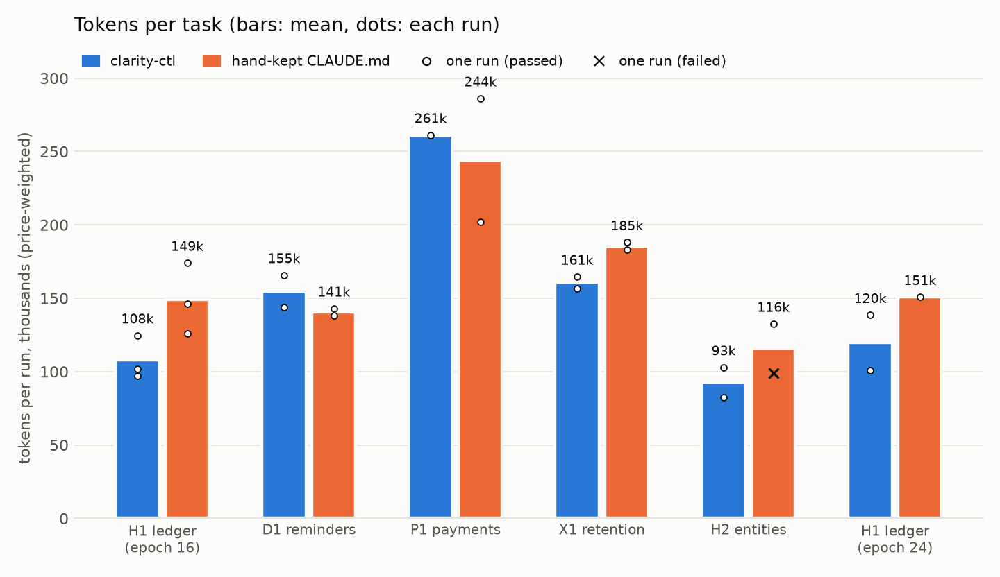

# clarity-ctl

**Your agent never forgets. Your project never sprawls. Your token bill shrinks.**

Stop babysitting your agent's memory. clarity-ctl turns every session into structured,
searchable project state, so the next one starts sharper and burns fewer tokens getting there.

No more "write a handoff file", no more hand-editing AGENTS.md, no more analysis or log files
scattered all over the codebase. Every session starts knowing where things stand, and ends with your project state
already primed for the next one.

Built for research, multi-repo work and projects where the direction isn't settled yet.

- **One CLI, one YAML file, 19 commands.** No server, no database, no embeddings, no model calls.
  `clarity-ctl help` lists them all.
- **Automatic.** The project state updates as a side effect of commands your agent already runs.
- **Organised.** One folder per task, worktrees out of the way, notes never pushed with your code.

## Four concepts, five minutes

| | What it is | You / your agent type |
|---|---|---|
| **Idea** | something to do later | `clarity-ctl idea "flaky test on macOS"` |
| **Epoch** | an idea being worked on: its own id, folder, branch and worktree | `clarity-ctl start 12` · `clarity-ctl close 12 "..."` |
| **Note** | a result, a finding, an approach rejected, written the moment it happens | `clarity-ctl note 12 "..."` |
| **Decision** | a rule that outlives the epoch, with an id (D7); a later one can replace it | `clarity-ctl note 12 "..." --decision --replaces D3` |

That's the whole model. An idea becomes an epoch with the same id; notes hang off either;
a decision stays listed until something replaces or retires it.

## Setup in one minute

Requires Python 3.10+ and git:

```sh
uv tool install git+https://github.com/danishnxt/clarity-ctl          # latest main
uv tool upgrade clarity-ctl                                           # pull the newest
```

## New project

```sh
mkdir parser && cd parser
clarity-ctl init --objective "Make the parser fast enough for 1GB inputs"
git clone git@github.com:you/parser.git workspace/parser
clarity-ctl repo add workspace/parser

clarity-ctl start "memory-map the input file" --repo all --brief "cut load time"
# idea 1, folder, branch, worktree, claimed; prints where to work

clarity-ctl note 1 "load time halved, total unchanged: the tokenizer is the bottleneck"
clarity-ctl idea "flaky test on macOS"          # for later: idea 2
clarity-ctl status                              # where things stand
clarity-ctl close 1 "no gain, I/O is not the bottleneck"
```

## Already have a repo?

Run `clarity-ctl adopt` inside it. Your agent restructures it once, and nothing moves
without your approval.

## What your agent sees

clarity-ctl keeps one marked block in your `AGENTS.md`, regenerated after every write
with no model calls: the rules for using clarity, then a short summary of where things
stand. Everything outside the block is yours.

```
Objective
---------
Make the parser fast enough for 1GB inputs

Active
------
- #3 memory-map the input file (work in `EPOCHS/003_2026-11-11__memory-map-the-input-file/wt/parser`) — handoff: mmap works; next profile the tokenizer, start with the deque in tokenize.py

Up next
-------
#1 flaky test on macOS · #2 parallel chunk parsing

Standing decisions, newest first
--------------------------------
- parse in 64KB chunks, never the whole file; memory stays flat (D1, #3)

Closed, newest first — `clarity-ctl show <id>` for the outcome and notes
#4 ✓ ring buffer for the tokenizer
```

## Why not just keep updating AGENTS.md?

- **Nobody has to remember to update it.** Your agent writes notes as it works; the block
  builds itself from them.
- **Only what's still relevant.** A AGENTS.md grows until it holds everything. clarity's
  block holds what's live; the rest of the history is a strctured `search` away.
- **Decisions stay in front of the agent.** A rule from March is still listed in November. This is because clarity-ctl does not rely solely on chronological ordering.
- **No contradictions.** A reversed decision leaves the active list.
- **Everything is a record.** Notes, decisions and handoffs have ids, links and dates, so
  they're searchable instead of buried in prose.

## Does it work?

**As good as a carefully kept AGENTS.md or better, for fewer tokens, with nobody keeping it
up to date.** Against a carefully hand-kept AGENTS.md, clarity-ctl passed 12/12 runs to its 11/12
and used 17% fewer tokens. An agent with no memory failed every run (0/3).

That is on a small project: about 24 sessions of history. Real projects run for hundreds, and
that's where the gap grows. A AGENTS.md has to fit everything into one file the agent reads in
full every session; by the end of this eval it was already 170 lines of its 200-line budget.
clarity's block stays short, and the rest of the history is a `search` away.

<picture>
  <source media="(prefers-color-scheme: dark)" srcset="docs/eval-dark.png">
  
</picture>

How it was measured: a synthetic billing library built over 24 scripted sessions by fresh
AGENTS Code (Sonnet) sessions. Decisions, reversals and handoffs were said in those sessions and
never written into the code. Each memory arm was kept up to date by the same agent after every
session, without seeing the tasks. Each batch's task prompts and test specs were committed before
that batch's history was built or remembered; tasks are graded by hidden tests, including tests that fail the fix you'd
write without knowing the history. The no-memory arm was run on the first of these tasks only; each cell
has 1–3 runs.
Everything is in [clarity-eval](https://github.com/danishnxt/clarity-eval#readme), with
transcripts, hidden tests and the commands to rerun it. It is also a submodule here at `eval/meterbill`,
pinned to the eval commit these numbers come from (`git submodule update --init` to fetch it).

## Reference

### Reading the state

`status` is the one-screen view; `--all` adds the 15 most recent closed and dropped
epochs (`--limit N` for more, `--order oldest` to read them as a story). Closed rows
show a **landed** mark read live from git, squash merges included, so the history shows
what stuck and what didn't, each with its reason. `show <id>` prints one item as a page:
outcome, folder, branch, repos, its decisions, a live handoff on top, and the latest 10
notes (`--all` for every one). `show decisions` lists the standing and retired decisions;
`show D<n>` gives one with the decisions it replaced (3 back, `--all` for the rest) and
the notes linked to each.

At a terminal the reads print tables. Anywhere else, which is how an agent's shell runs
them, they print plain text with no boxes or colour, about a seventh the size for lists:

```
$ clarity-ctl show closed | cat
Closed (2), newest first
#2 ✓ ring buffer for the tokenizer · #1 ✓ memory-map the input file
```

Closing never merges and never deletes a branch: merge first if the work should land.
When the closed list gets long, `archive` moves it out of `worklog.yaml`; folders stay,
ids are never reused, and `show <id>` still reads archived epochs.

Notes are never edited; a later note that corrects an earlier one should say so. A note
about a decision links to it with `--on D<n>`. A decision that stops being true is
retired: a new one with `--replaces D<n>`, or `close D<n> "why"`, or `close D<n> --by D<m>`
when the replacement already exists. Stopping before the work is done, the agent's last
write is `note <id> "..." --handoff`: it shows in the state block until the next session's
first note on that epoch takes it up. Glance
at `show <id>` before you close, since a fast agent can forget to write notes. A claim is
a **lease**, a warning of who is working on an epoch, not a lock.

### `--json` for scripts

`status`, `show` and `search` take `--json` and answer
`{ok, command, data, warnings, version}`; a failure has `ok: false` with `error` and
`code` in place of `data`. Every other command prints text, with errors on stderr.
`status --json` lists each item with a `note_count`; `show <id> --json` has the latest 10
notes and `notes_omitted` (`--all` for every one); `show D<n> --json` and
`show decisions --json` have the decisions.
Exit codes: `0` ok · `1` error · `2` validation failed · `3` not a clarity project · `4` refused.

### Multi-repo projects

Your code lives under `workspace/`, one repo or several. List each one you change with
`repo add <path>`. `start` then asks which to branch: `--repo <name>` (repeat for more),
`--repo all`, or `--repo none` for planning or analysis. `show repos` lists them;
`add-repo` and `drop-repo` change an epoch's set later.

### Splitting work across agents

When one epoch is too big for one agent, its owner spawns a **subepoch** per part:

    clarity-ctl spawn 7 "port expressions" --brief "Expressions only. Don't touch the lexer."

Subepochs are numbered under their parent (7.1, 7.2), branch from 7's branch and merge
back into it; only 7 merges to main. The part's agent claims it (`claim 7.1 --as
expr-agent`), works in the folder `spawn` printed and stops with a `--handoff` note. 7's
owner reviews (feedback goes in a note on 7.1), merges 7.1 into 7 and closes it;
`refresh 7.2` brings the merged work into a sibling. `show 7` gathers each subepoch's
outcome or live handoff, and 7 can't close while one is active.

### Existing projects

Run `clarity-ctl adopt` in the folder.

- **A git repo**: adopt moves all of it, history and uncommitted work included, to
  `workspace/<folder name>/`. A virtualenv or anything with absolute paths needs
  rebuilding.
- **Several checkouts and loose files**: adopt writes `.clarity/adopt.md`, a procedure
  for an agent: repos you change go to `workspace/`, repos you only use to `3rd_party/`,
  past results into a closed baseline epoch. Every move waits for your approval.

After an upgrade, the next write in each project brings its agent rules and
`worklog.yaml` up to date (`init` in the project does it at once). An older clarity-ctl
reads a newer worklog but refuses to write it.

### License

MIT — see [LICENSE](LICENSE).
