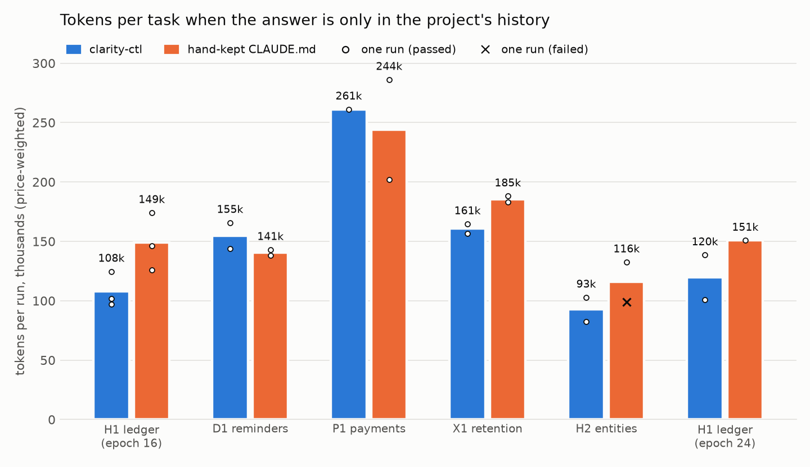

**Problem 1: You're still telling your coding agent what to put in handoff files and AGENTS.md?**

Every session ends the same way: "write a handoff", "add that to CLAUDE.md", "no, the
other decision". Forget once, and the next session burns tokens rediscovering what you
already decided: things you already paid tokens for, sitting in the last session's context and cache.

> clarity-ctl makes that project bookkeeping automatic. Your agent records decisions as it
works, and every new session starts already knowing where things stand. Nothing to
remember, nothing to dump at the end.

**Problem 2: Running experiments with no clear direction yet?**

Your agent will clobber your project structure with ad hoc files everywhere, until you never want to open the directory yourself.

> clarity-ctl brings order and structure for free: everything is always findable by you **or** your agent. Logs, analyses, graphs, findings, worktrees, everything.

## clarity-ctl

**Thin, light, robust.** One simple CLI, one YAML file, 20 commands. No server, no database, no
embeddings, no model calls. Simple.

## Three concepts, five minutes

| | What it is | You / your agent type |
|---|---|---|
| **Idea** | something to do later | `clarity-ctl idea "flaky test on macOS"` |
| **Epoch** | an idea being worked on: its own id, folder, branch and worktree | `clarity-ctl start 12` · `clarity-ctl close 12 "..."` |
| **Note** | a decision or a result, written the moment it happens | `clarity-ctl note 12 "DECISION: ..."` |

That's the whole model. An idea becomes an epoch with the same id; notes hang off either.
Everything else is a view of those three.

## Setup in one minute

Requires Python 3.10+ and git. Installs from GitHub:

```sh
uv tool install git+https://github.com/danishnxt/clarity-ctl          # latest main
uv tool upgrade clarity-ctl                                           # pull the newest
```

## New project workflow

```sh
# setup
mkdir parser && cd parser
clarity-ctl init --objective "Make the parser fast enough for 1GB inputs"
git clone git@github.com:you/parser.git workspace/parser
clarity-ctl repo add workspace/parser

# begin work
clarity-ctl start "memory-map the input file" --repo all --brief "cut load time"
# idea 1, folder, branch, worktree, claimed; prints where to work

clarity-ctl note 1 "load time halved, total unchanged: the tokenizer is the bottleneck"
clarity-ctl idea "flaky test on macOS"          # for later: idea 2
clarity-ctl status                              # where things stand
clarity-ctl close 1 "no gain, I/O is not the bottleneck"
```

## Already have a repo?

Run `clarity-ctl adopt` inside it instead. Your agent restructures it once, and nothing moves without your approval. It's a one-time setup: the earlier you do it, the better.

## What your agent sees

clarity-ctl maintains one marked block in your `AGENTS.md` (added at the end if the file already exists):

1. **Rules:** written by `init`, telling your agent how to use clarity.

2. **Where things stand:** a current-state summary that gives your agent a jumping-off point back into the project, like a very small CLAUDE.md. clarity regenerates it after every write, from the epochs and notes already recorded, with no model calls.

3. Everything outside the block is yours: put whatever you'd normally put in this file.

```
**Objective:** Make the parser fast enough for 1GB inputs

**Active**
- #3 memory-map the input file (work in `EPOCHS/003_2026-11-11__memory-map-the-input-file/wt/parser`) — handoff: mmap works; next profile the tokenizer, start with the deque in tokenize.py

**Up next:** #1 flaky test on macOS · #2 parallel chunk parsing

**Standing decisions**, newest first
- parse in 64KB chunks, never the whole file; memory stays flat (#3)

**Closed**, newest first — `clarity-ctl show <id>` for the outcome and notes
#4 ✓ ring buffer for the tokenizer

...

# YOUR AGENTS.MD content #

```

## Why not just CLAUDE.md?

- **CLAUDE.md is a file someone has to remember to update.** clarity's state changes as
  a side effect of commands the agent runs anyway.
- **Decisions are tied to the work they came from**, with an id and a date.
- **Standing decisions are listed for every session**, so a rule made in March is still
  in front of the agent in November.
- **The project folder stays organised.** One folder per epoch, plans and results
  inside it, worktrees out of the way, and code in its own repo so pushing code never
  pushes notes.

## Does it work?

**When the answer lives only in the project's history, an agent with no memory got it wrong
every time (0/3); with clarity-ctl it passed every run (12/12), and used 17% fewer tokens across
those runs than with a carefully hand-kept CLAUDE.md (11/12)** — 13–28% cheaper on 4 of the 6
tasks, 7–10% dearer on the other 2. When the answer is in the code, memory doesn't matter: every
arm passes, and keeping memory costs roughly 12–17k tokens a task.

<picture>
  <source media="(prefers-color-scheme: dark)" srcset="eval/meterbill/eval-dark.png">
  
</picture>

How it was measured: a synthetic billing library built over 24 scripted sessions by fresh
Claude Code (Sonnet) sessions. Decisions, reversals and handoffs were said in those sessions and
never written into the code. Each memory arm was kept up to date by the same agent after every
session, without seeing the tasks. Each batch's task prompts and test specs were committed before
that batch's history was built or remembered; tasks are graded by hidden tests, including tests that fail the fix you'd
write without knowing the history. The no-memory result comes from one task (it was not run on
the later five), and samples are small (1–3 runs per cell), so read the token gaps as direction,
not precision.
Everything is in [`eval/meterbill/`](eval/meterbill/README.md), with transcripts, hidden tests and
the commands to rerun it.

## Commands

    read      status · show · search · help
    on an id  start · close · note · spawn · refresh · claim · rename · add-repo · drop-repo
    capture   idea
    tidy      archive
    set up    init · adopt · objective · repo add|remove

`clarity-ctl <command> --help` has each one's flags and an example; `clarity-ctl help reference`
prints them all on one page. Commands take the epoch's id: clarity never guesses which one you mean.

## Reference

### Reading the state

`status` is the one-screen view; `--all` adds the 15 most recent closed and dropped
epochs (`--limit N` for more, `--order oldest` to read them as a story). Closed rows
show a **landed** mark read live from git, squash merges included, so the history shows
what stuck and what didn't, each with its reason. `show <id>` prints one item as a page:
outcome, folder, branch, repos and every note, latest handoff first.

At a terminal the reads print tables. Anywhere else, which is how an agent's shell runs
them, they print plain text with no boxes or colour, about a seventh the size for lists:

```
$ clarity-ctl show closed | cat
Closed (2), newest first
#2 ✓ ring buffer for the tokenizer · #1 ✓ memory-map the input file
```

Closing never merges and never deletes a branch: merge first if the work should land.
When the closed list gets long, `archive` moves it out of `worklog.yaml`; folders stay,
ids are never reused, and `show <id>` still reads archived epochs.

Notes are never edited; a later note that corrects an earlier one should say so. Glance
at `show <id>` before you close, since a fast agent can forget to write notes. A claim is
a **lease**, a warning of who is working on an epoch, not a lock.

### `--json` for scripts

`status`, `show` and `search` take `--json` and answer
`{ok, command, data, warnings, version}`; a failure has `ok: false` with `error` and
`code` in place of `data`. Every other command prints text, with errors on stderr.
`status --json` lists each item with a `note_count`; `show <id> --json` has the notes.
Exit codes: `0` ok · `1` error · `2` validation failed · `3` not a clarity project · `4` refused.

### Multi-repo projects

Your code lives under `workspace/`, one repo or several. List each one you change with
`repo add <path>`. `start` then asks which to branch: `--repo <name>` (repeat for more),
`--repo all`, or `--repo none` for planning or analysis. `show repos` lists them;
`add-repo` and `drop-repo` change an epoch's set later.

### Splitting work across agents

When one epoch is too big for one agent, its owner spawns a **subepoch** per part:

    clarity-ctl spawn 7 "port expressions" --brief "Expressions only. Don't touch the lexer."

Subepochs are numbered under their parent (7.1, 7.2), branch from 7's branch and merge
back into it; only 7 merges to main. The part's agent claims it (`claim 7.1 --as
expr-agent`), works in the folder `spawn` printed and stops with a `HANDOFF:` note. 7's
owner reviews (feedback goes in a note on 7.1), merges 7.1 into 7 and closes it;
`refresh 7.2` brings the merged work into a sibling. `show 7` gathers each subepoch's
outcome or latest handoff, and 7 can't close while one is active.

### Existing projects

Run `clarity-ctl adopt` in the folder.

- **A git repo**: adopt moves all of it, history and uncommitted work included, to
  `workspace/<folder name>/`. A virtualenv or anything with absolute paths needs
  rebuilding.
- **Several checkouts and loose files**: adopt writes `.clarity/adopt.md`, a procedure
  for an agent: repos you change go to `workspace/`, repos you only use to `3rd_party/`,
  past results into a closed baseline epoch. Every move waits for your approval.

After an upgrade, the next write in each project brings its agent rules and
`worklog.yaml` up to date (`init` in the project does it at once). An older clarity-ctl
reads a newer worklog but refuses to write it.

### License

MIT — see [LICENSE](LICENSE).
